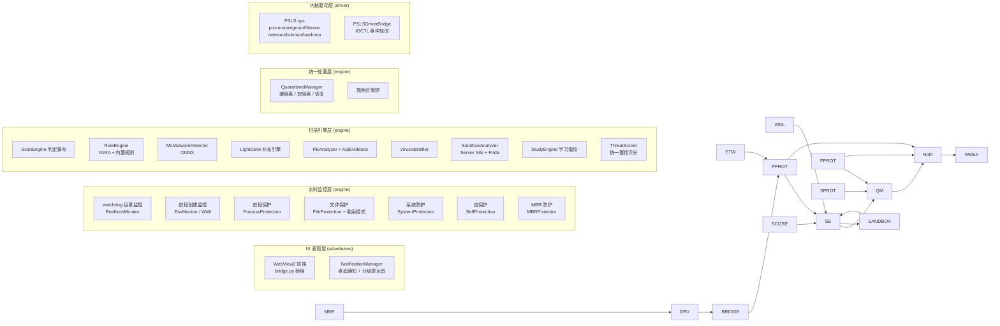
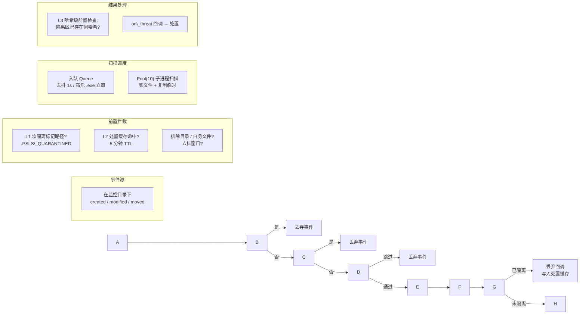
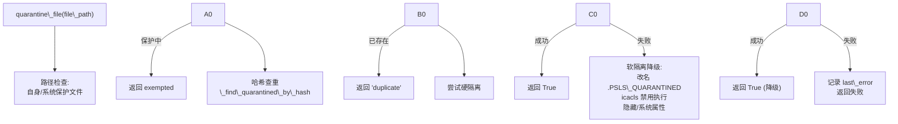
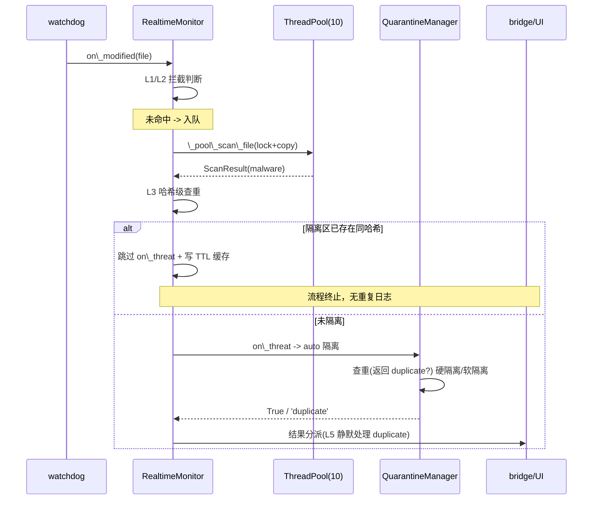
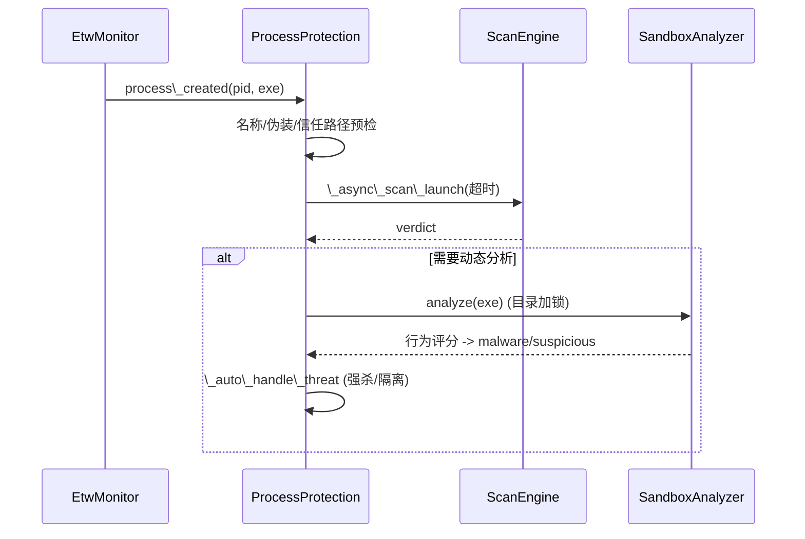

# PSLS 防护处置系统架构设计文档

> 版本：26.0.x ｜ 适用范围：PSLS 主程序（engine + driver + ui/webview）
> 文档基于对真实源码的核查编写，所有模块路径与阈值均来自当前代码库实现。
>
> **开源构建说明**：本文档描述完整版架构。Dantrolene V1 私有引擎（模型、特征
> 管线与推理实现）未包含在本仓库中，文内相关章节仅用于说明接口位置与降级行为。

\---

## 目录

1. [系统概述](#1-系统概述)
2. [总体架构](#2-总体架构)
3. [实时监控子系统](#3-实时监控子系统)
4. [扫描引擎子系统](#4-扫描引擎子系统)
5. [统一处置子系统](#5-统一处置子系统)
6. [辅助防护子系统](#6-辅助防护子系统)
7. [内核驱动与桥接层](#7-内核驱动与桥接层)
8. [UI 与通知表现层](#8-ui-与通知表现层)
9. [幂等去重机制设计](#9-幂等去重机制设计)
10. [关键流程时序](#10-关键流程时序)
11. [模块清单与职责](#11-模块清单与职责)
12. [运行时依赖与资源](#12-运行时依赖与资源)

\---

## 1\. 系统概述

PSLS 是一套面向 Windows 的主动防御安全软件，采用**用户态多引擎检测 + 内核态驱动拦截**的纵深防御架构。核心能力划分为两大主线：

|主线|职责|入口|
|-|-|-|
|**实时监控**|监听文件系统变化、进程创建、注册表变更，第一时间触发扫描与处置|`RealtimeMonitor`|
|**扫描引擎**|多引擎流水线（静态 / AI / 动态行为）对样本判定 malware / suspicious / clean|`ScanEngine`|

两条主线汇合于**统一处置层**（`QuarantineManager`），处置结果通过通知管理层反馈给用户。

系统关键设计目标：

1. **多引擎交叉验证**：单引擎"malware"若无法被其他引擎佐证则降级为 suspicious，降低误报。
2. **统一置信标尺**：各引擎异构证据（签名/规则/ML/PE/API 指纹/沙箱/学习引擎）归一化到 0-100 分，按 82 / 56 分档。
3. **处置幂等**：同一文件（同一哈希）只应被隔离一次，杜绝 watchdog 事件风暴导致的重复隔离与日志刷屏（见 [第 9 章](#9-幂等去重机制设计)）。

\---

## 2\. 总体架构

**分层职责**：

* **实时层**：事件源采集 + 前置拦截 + 威胁回调上抛。所有路径都需先过**幂等拦截**再入队扫描。
* **扫描层**：判定流水线，无状态、可并行，产出统一 verdict。
* **处置层**：对判定为威胁的文件执行隔离/恢复/删除，是幂等语义的唯一权威。
* **内核层**：内核事件采集（进程/注册表/文件/网络/磁盘）与强制性拦截（MBR 回滚、进程终止）。

\---

## 3\. 实时监控子系统

核心代码：[realtime\_monitor.py](engine/realtime_monitor.py)

### 3.1 总体流水线

### 3.2 事件采集（`\_ThreatHandler`）

`\_ThreatHandler(FileSystemEventHandler)`（[第 532 行](engine/realtime_monitor.py#L532)）基于 watchdog 监听：

* `on\_created` / `on\_modified` / `on\_moved` 统一路由到 `\_on\_any`。
* 监控目录来源于 `get\_critical\_watch\_dirs()`（[第 352 行](engine/realtime_monitor.py#L352)），包括用户目录关键位置；`get\_all\_local\_drives()`（[第 383 行](engine/realtime_monitor.py#L383)）枚举本地盘。

### 3.3 前置拦截层（L1 / L2）

针对"文件被反复检测隔离"问题的第一道防线，位于 `\_on\_any` 入口（[第 584-592 行附近](engine/realtime_monitor.py#L539)）：

|拦截点|判据|效果|
|-|-|-|
|**L1 软隔离标记**|`\_is\_quarantined\_marker\_path(p)`：路径以 `.PSLS\_QUARANTINED` 结尾|原地软隔离产生的标记文件本身不再触发扫描|
|**L2 处置缓存**|`\_is\_file\_disposed(p)`：路径在 `\_RT\_DISPOSITION\_CACHE` 中且未超 TTL|已处置文件在 5 分钟窗口内不再重复入队|

处置缓存实现要点（[第 430-470 行](engine/realtime_monitor.py#L430)）：

* `\_RT\_DISPOSITION\_CACHE\_TTL = 300`（秒）。
* `\_mark\_file\_disposed(file\_path)`：写入 `{path: timestamp}`，带线程锁。
* `\_is\_file\_disposed(file\_path)`：命中且未过期返回 True，并惰性清理过期条目。

### 3.4 扫描调度（`RealtimeMonitor`）

* **处理器池**：`multiprocessing.Pool(10)`，`\_pool\_scan\_file`（[第 220 行](engine/realtime_monitor.py#L220)）。
* **加锁复制**：`\_lock\_and\_copy\_temp`（[第 72 行](engine/realtime_monitor.py#L72)）用 `CreateFileW(share=0)` 独占锁文件后复制临时副本扫描，避免与真实文件竞争；`\_lock\_file\_exclusive`（[第 156 行](engine/realtime_monitor.py#L156)）。
* **去抖策略**：普通文件 1 秒去抖窗口；高危扩展名（`.exe` 等）跳过去抖立即入队（`\_enqueue\_scan`，[第 1117 行](engine/realtime_monitor.py#L1117)）。
* **扫描循环**：`\_scan\_loop` → `\_scan\_single` → `\_on\_pool\_result\_done` → `\_process\_scan\_results`。

### 3.5 哈希级前置去重（L3）

`\_process\_scan\_results`（[第 1304 行](engine/realtime_monitor.py#L1304)）在触发 `on\_threat` 回调前：

1. 计算文件 SHA-256；
2. 调用 `quarantine\_manager.is\_hash\_quarantined(file\_hash)` 查询隔离区；
3. 命中 → **跳过 on\_threat 回调**，并 `\_mark\_file\_disposed` 写入处置缓存（双保险）；
4. 未命中 → 正常进入处置流程。

由此，即使 L1/L2 未拦截，隔离区哈希查重也会兜底阻断重复处置。

### 3.6 处置路径

`on\_threat` 上报后按用户/系统策略二选一：

* **auto 自动处置**：锁文件 → 驱动/API 级别终止关联进程 → `QuarantineManager.quarantine\_file` 隔离 → 失败降级删除 → 删除兜底仍失败则软隔离。
* **notify 询问处置**：进入优先级队列（危险询问 > 可疑询问 > 沙箱放行 > 隔离结果），由前端弹出处理。

\---

## 4\. 扫描引擎子系统

核心代码：[scan\_engine.py](engine/scan_engine.py)（`ScanEngine.scan\_file` 判定瀑布，[第 1737 行](engine/scan_engine.py#L1737)）、[threat\_scorer.py](engine/threat_scorer.py)。

### 4.1 判定瀑布总体顺序

```mermaid
flowchart TD
    S\["scan\_file 入口"] --> S0\["自身文件/信任目录/大小限制<br/>提前放行"]
    S0 --> S1\["受信进程目录?<br/>跳过规则/PE 深度分析"]
    S1 --> S2\["签名库哈希匹配<br/>命中 -> malware (最高优先)"]
    S2 --> S3\["可信签名快速放行<br/>Microsoft/Adobe/Google 等"]
    S3 --> S4\[".lnk 快捷方式解析<br/>目标路径安全评估"]
    S4 --> S5\["模糊哈希 CTPH 兜底<br/>同源样本命中 -> suspicious"]
    S5 --> S6\["规则引擎<br/>YARA + 内置规则扫描"]
    S6 --> S7\["VirusIdentifier 综合引擎<br/>PE + 非 PE (JS/VBS...)"]
    S7 --> S8\["PE 结构分析<br/>PEAnalyzer + ApiEvidence"]
    S8 --> S9\["ML 检测 <br/>ONNX 主引擎"]
    S9 --> S10\["LightGBM 补充引擎<br/>273 维特征"]
    S10 --> S11\["统一置信评分<br/>ThreatScorer 0-100"]
    S11 --> S12\["verdict: malware/suspicious/clean"]
```

### 4.2 静态识别层

|引擎|位置|机制|
|-|-|-|
|签名库精确匹配|`signature\_db.is\_malware(file\_hash)`|SHA-256 精确命中即 malware，最高优先级；命中后 `get\_malware\_info` 返回的缓存实例做了**防御性拷贝**，避免 name 前缀无限叠加（"签名库发现威胁: 签名库发现威胁: ..."）|
|白名单|`signature\_db.is\_whitelisted(file\_hash)`|白名单哈希直接返回 clean|
|YARA 规则|[yara\_portable.py](engine/yara_portable.py) + [rule\_engine.py](engine/rule_engine.py)|`YaraPortable` 便携 Python 子进程桥接，磁盘规则 `.yar` + DB 自动规则并联；缓存路径 `compiled.yc`|
|内置启发式规则|`RuleEngine.\_builtin\_scan\_file`|字节模式匹配，含文件名规则（`\_scan\_filename\_rules`）与威胁情报（`\_scan\_threat\_intel`）|
|模糊哈希|CTPH（`fuzzy\_file` / `fuzzy\_compare`）|精确 miss 时同源样本兜底，`FUZZY\_THRESHOLD` 判定|

### 4.3 AI 推理层

|引擎|位置|关键参数|
|-|-|-|
|ONNX 主引擎|[ml\_detector.py](engine/ml_detector.py) `MLMalwareDetector`|模型 `models/malware\_detector.onnx`；ware 阈值 ≥0.75、suspicious ≥0.55（严格模式）|
|LightGBM 补充引擎|[lightgbm\_engine.py](engine/lightgbm_engine.py) `LightGBMClassifier`|273 维特征（16 PE + 32 Bigram + 225 字节直方图），`lib\_lightgbm.dll` 推理，带归一化 + 保序校准；**话语权高于 ONNX**|

特征提取：`MLFeatureExtractor`（[ml\_detector.py#L413](engine/ml_detector.py#L413)），含 PE 结构增强特征、节区统计、导入表快速解析。

### 4.4 动态分析层（沙箱）

核心代码：[sandbox\_analyzer.py](engine/sandbox_analyzer.py)

* **隔离容器**：`SandboxConfig` + Job Object（`\_create\_job\_object`）+ 受限令牌（`\_restrict\_process\_token`），AppContainer 级资源限制。
* **进程管理**：`\_launch\_sandboxed` 低权限启动；`\_terminate\_job` 结束；`\_detect\_escaped\_processes` + `\_kill\_escaped\_descendants` 兜底逃逸子进程；`\_block\_process\_net` 阻断网络。
* **行为采集**：psutil 轮询 + Frida hook（`\_setup\_frida\_hooks` / `\_build\_frida\_script`，27 个 API hook），`\_monitor\_behavior` 记录 6 类行为。
* **静态预检**：`\_static\_precheck` / `\_static\_precheck\_pe` / `\_static\_precheck\_strings` 无代码执行先判定。
* **评分**：`\_score\_behaviors` 按 6 维加权：文件 20 / 注册表 15 / 网络 15 / 进程 20 / 系统 15 / 反分析 15；≥60 判 malware，≥30 判 suspicious。

### 4.5 决策融合（统一置信评分）

核心代码：[threat\_scorer.py](engine/threat_scorer.py)

|阈值|值|说明|
|-|-|-|
|`CONF\_MALWARE`|82.0|≥82 → malware|
|`CONF\_SUSPICIOUS`|56.0|\[56, 82) → suspicious|
|`CONF\_CLEAN`|0.0|<56 → clean|

证据加权（弱信号累加，**只做加法**）：

|证据|权重|
|-|-|
|YARA high 规则|+40 / 条|
|内置 high 规则|+32 / 条|
|medium / low|+16 / +6|
|ML malware 概率|+70 × prob|
|ML suspicious 概率|+40 × prob|
|PE 得分|+0.30 × score|
|API/导入证据|+18 × (api/45)|
|学习引擎 malicious / benign|+20 / −18|

特殊处理：

* `signature\_benign` 或 `trusted\_signer` → **强抑制**直接 5.0；
* `signature\_mal` → 直接 100.0（确认型证据不稀释）；
* `vi\_critical` → 直接 94.0。

**交叉验证规则**：单引擎 malware 若无强证据佐证，由 `\_confirm\_weak\_suspicious`（[scan\_engine.py#L1731](engine/scan_engine.py#L1731)）把关，弱于 56 分不维持 suspicious，避免误报。

### 4.6 辅助分析器

* [PEAnalyzer](engine/pe_analyzer.py)：PE 头/节区/导入表/TLS 回调/资源比/加壳检测/熵分析，输出 `risk\_score` 0-100。
* [VirusIdentifier](engine/virus_identifier.py)：覆盖 PE + 非 PE（脚本/纯数据）7 维综合识别，输出 score + severity。
* [api\_evidence.py](engine/api_evidence.py)：ApiHash/导入表权重证据信号。
* [study\_engine.py](engine/study_engine.py)：本地学习指纹（哈希+大小+扩展名+API 历史），良性/恶性近似匹配，用于弱证据加减分。
* [threat\_intel.py](engine/threat_intel.py)：IP/域名黑名单库，支持用户黑名单目录加载。

\---

## 5\. 统一处置子系统

核心代码：[quarantine\_manager.py](engine/quarantine_manager.py)

### 5.1 处置三态（幂等语义）

`quarantine\_file`（[第 531 行](engine/quarantine_manager.py#L531)）返回值为**三态语义**：

|返回值|含义|调用方处理|
|-|-|-|
|`True`|本次**新增**隔离成功|正常记录"已隔离"、弹窗、计数|
|`'duplicate'`|同哈希**已在隔离区**，未新增条目|静默跳过：不写成功日志、不弹窗、不计数|
|`'exempted'`|文件在豁免区/受保护路径|静默跳过|

去重判断：`\_find\_quarantined\_by\_hash(file\_hash)`（[第 492 行](engine/quarantine_manager.py#L492)）只匹配**未删除/未恢复**的隔离条目。

公共查询接口：`is\_hash\_quarantined(file\_hash) -> bool`（[第 511 行](engine/quarantine_manager.py#L511)），供实时监控 L3 前置检查调用。

### 5.2 隔离执行路径

* **硬隔离**：`\_encrypt\_file`（AES 混淆）→ 移动至隔离目录 → 删除原文件 → 记录 metadata（`\_save\_metadata`）。隔离区文件已通过 `\_fix\_file\_permissions` / `\_prep\_for\_remove` 处理 ACL。
* **软隔离降级**（硬隔离失败时）：改名加 `.PSLS\_QUARANTINED` 后缀 + `icacls` 禁用执行/继承 + 设置隐藏、系统属性。此路径正是实时监控 L1 拦截的目标标记。
* **进程处置前置**：`terminate\_malware\_process`（[第 1023 行](engine/quarantine_manager.py#L1023)）先杀掉占用文件进程，`\_kill\_processes\_for\_file` / `\_detect\_processes\_for\_file`。

### 5.3 恢复与删除

* `restore\_file(quarantine\_id)`：解密 → 回写原路径 → 恢复权限。
* `delete\_file(quarantine\_id)`：物理删除条目。
* 批量：`restore\_files\_batch` / `delete\_files\_batch`（带幂等与失败逐项回滚）。

### 5.4 豁免区

`\_add\_exemption` / `is\_path\_exempted` / `\_is\_self\_protected` / `\_is\_system\_protected`（[第 145/162/255 行](engine/quarantine_manager.py#L145)）：PSLS 自身安装目录、系统关键目录、用户配置的黑名单目录不参与隔离。

\---

## 6\. 辅助防护子系统

### 6.1 进程保护 ProcessProtection

核心代码：[process\_protection.py](engine/process_protection.py)

* **事件源**：ETW/WMI 进程创建（`EtwMonitor` 桥接）为主，WTS 轮询为兜底；`\_watchdog\_loop` + `\_monitor\_loop` 常驻。
* **检测项**（`\_check\_new\_process`，[第 1407 行](engine/process_protection.py#L1407)）：

  * 进程哈希扫描（`\_check\_process\_hash`，带超时与独立扫描引擎）；
  * 可疑 / 混淆名称（`\_is\_suspicious\_name` / `\_is\_confused\_name`）；
  * 伪冒系统二进制（`\_is\_masquerading\_system\_binary`）；
  * 注入特征（RWX 区域、远程线程、`\_has\_injection\_features`）；
  * 沙箱关联（`\_is\_sandbox\_descendant` / `\_is\_in\_psls\_sandbox\_dir`）。
* **处置**：`\_auto\_handle\_threat` → 强杀 / 豁免；注入处置走 `\_handle\_injection\_threat` → `\_strip\_injection`（释放 RWX 内存）。
* **沙箱协调**：分析中目录加锁（`\_mark\_sandbox\_analyzing` / `\_is\_sandbox\_analyzing`），避免与沙箱重复处置（`release\_sandbox\_lock`）。

### 6.2 文件保护 FileProtection

核心代码：[file\_protection.py](engine/file_protection.py)

* 监听受保护目录事件（`\_ProtectedFileHandler`）+ 完整性基线（`\_build\_baselines`、`\_compute\_file\_hash`）。
* **篡改检测**：`\_check\_file\_tampering` 比对哈希基线，改动超过阈值触发。
* **删除防护**：`\_handle\_file\_deletion` → `\_try\_restore` 从备份回滚。
* **勒索软件模式**：`\_detect\_ransomware\_pattern` 统计短时大量修改（窗口内文件数），触发 `\_on\_ransomware\_detected` → 隔离参与进程 + 批量回滚；`result is True` 才计入"已隔离"成功计数（防止 duplicate 误增）。

### 6.3 系统防护 SystemProtection

核心代码：[system\_protection.py](engine/system_protection.py)

* 注册表持久化基线（`\_build\_registry\_baselines`）+ WMI 注册表事件订阅（`\_on\_wmi\_registry\_event`）。
* 持久化检查：启动项（`\_check\_startup\_items`）、计划任务（`\_check\_scheduled\_tasks`）、AppInit\_DLLs（`\_check\_appinit\_dlls`）、WMI 持久化（`\_check\_wmi\_persistence` / `\_check\_advanced\_persistence`）。
* hosts 文件完整性（`\_check\_hosts\_file` / `\_get\_hosts\_diff`），变化即告警并回滚。

### 6.4 自保护 SelfProtection

核心代码：[self\_protection.py](engine/self_protection.py)

* 进程 DACL 保护（`\_apply\_process\_dacl\_protection` SDDL 限制句柄访问）。
* 调试器检测（`\_check\_debugger` / `\_check\_remote\_debugger` / 端口扫描）。
* 注入与远程线程检测（`\_check\_injection` / `\_check\_remote\_thread\_injection` / 线程数异常）。
* 关键文件监控（`\_init\_critical\_files` + 基线），自身文件只读属性防护。
* 内核模式激活/停用（`\_try\_activate\_kernel\_protection`）。

### 6.5 MBR 防护 MBRProtector

核心代码：[mbr\_protector.py](engine/mbr_protector.py)

* 启动时备份系统盘 MBR/引导扇区（`create\_backup` / `\_save\_backup\_to\_disk`）。
* 周期校验（`\_check\_all`），篡改即 `\_handle\_tamper` → `\_restore\_one\_locked` 自动回滚。
* 依赖 diskmon 驱动的 `IRP\_MJ\_WRITE` 事前拦截（`\_enable\_driver\_mon`）。

\---

## 7\. 内核驱动与桥接层

### 7.1 PSLS.sys 驱动

源码位于 `driver/src/`（psls\_driver.c + procmon/regmon/filemon/netmon/diskmon/loadmon）：

|子模块|拦截能力|
|-|-|
|procmon|`PsSetCreateProcessNotifyRoutineEx` 进程创建/终止回调|
|regmon|`CmRegisterCallbackEx` 注册表回调|
|filemon|文件操作监控|
|netmon|网络访问监控|
|diskmon|MBR 写拦截（`IRP\_MJ\_WRITE`），事前阻断 + 回滚|
|loadmon|镜像加载监控|

共享头 `include/psls\_shared.h` 定义事件协议。

### 7.2 PSLSDriverBridge

核心代码：[psls\_driver\_bridge.py](driver/bridge/psls_driver_bridge.py)

* 通过 `DeviceIoControl` 与驱动通信（`\_ioctl`）。
* 事件模型：`ProcessCreateEvent` / `RegKeyEvent` / `ImageLoadEvent` / `BlockResultEvent` / `FileBlockEvent` / `NetBlockEvent` / `DiskBlockEvent` / `DriverStatus`。
* `poll\_events` 轮询内核事件环（5ms 间隔），`ack\_event` 确认处置动作。
* `terminate\_process` / `block\_process` / `allow\_process` 由用户态下发内核执行。

\---

## 8\. UI 与通知表现层

### 8.1 WebView2 桥接

核心代码：[bridge.py](ui/webview/bridge.py)（`ui/webview/`）

* **初始化**：构造 `RealtimeMonitor(..., quarantine\_manager=self.\_quarantine\_manager)`（[第 3148-3156 行](ui/webview/bridge.py#L3148)），将隔离器注入监控器，支撑 L3 哈希查重。
* **处置返回值三态分派**：

  * `\_auto\_process\_threat`（[第 11657-11683 行](ui/webview/bridge.py#L11657)）：`result == 'duplicate'` → 静默 INFO 日志 + `action='duplicate'`，**不再写"已隔离: xxx"成功活动日志**。
  * `\_on\_realtime\_threat`：`action == 'duplicate'` → 跳过桌面结果弹窗、跳过分级提示音、跳过实时威胁计数（`threat\_count`），仅保留一条静默日志。
  * 沙箱兜底 / 大文件降级 / 删除降级等调用点（[第 4327-4350](ui/webview/bridge.py#L4327)、[8859-8880](ui/webview/bridge.py#L8859)、[8923-8943](ui/webview/bridge.py#L8923)、[11410-11418](ui/webview/bridge.py#L11410)）同步补齐 `duplicate` 静默分支。

### 8.2 通知管理

核心代码：[notification\_manager.py](engine/notification_manager.py)

* `NotificationLevel` 分级：critical / warn / info 等。
* 双通道：桌面通知（`is\_desktop\_enabled`）+ 分级提示音（`is\_sound\_enabled`，音源 `critical.mp3` / `error.mp3` / `warn.mp3` 等）。
* 历史与统计：`get\_history` / `get\_history\_stats`，配置持久化到 `config/notification\_settings.json`。

\---

## 9\. 幂等去重机制设计

### 9.1 问题背景

实时监控下，同一恶意文件会因以下原因被反复处置：

1. 软隔离降级后，原路径仍触发 watchdog（`.PSLS\_QUARANTINED` 文件持续产生事件）；
2. 硬隔离后的文件属性变更仍可能再次触发同一路径事件；
3. 隔离成功也被上层当作"新隔离"上报表现层，造成日志刷屏、重复弹窗与计数。

### 9.2 多层硬隔离（任意一层生效即可阻断）

|层级|位置|机制|作用域|
|-|-|-|-|
|L1 路径级|`realtime\_monitor.\_on\_any`|`.PSLS\_QUARANTINED` 后缀跳过入队|软隔离标记文件|
|L2 路径级|`realtime\_monitor.\_on\_any`|`\_is\_file\_disposed` 5 分钟 TTL 缓存|已处置路径|
|L3 哈希级|`realtime\_monitor.\_process\_scan\_results`|`is\_hash\_quarantined(sha256)` 前置查询，命中跳过 `on\_threat`|隔离区已存在哈希|
|L4 语义级|`quarantine\_manager.quarantine\_file`|命中去重返回 `'duplicate'` 而非 `True`|隔离器返回值契约|
|L5 表现层|`bridge.py` 各调用点|duplicate 分支静默：不写成功日志、不弹窗、不计入计数|UI/通知|

### 9.3 关键约定

* 所有 `if result:` 判定一律改为 `if result is True:`（`process\_protection.py` / `file\_protection.py` 已同步），杜绝 `'duplicate'` 这类真值字符串被误判为成功。
* L3 命中时同时写 L2 处置缓存，形成双保险：即使哈希查重失败（如隔离区异常），TTL 缓存仍能兜底。
* 隔离条目删除/恢复后，`\_find\_quarantined\_by\_hash` 不再匹配，文件可被重新隔离（语义正确）。

\---

## 10\. 关键流程时序

### 10.1 实时监控 → 扫描 → 处置

### 10.2 进程保护 → 沙箱联动

\---

## 11\. 模块清单与职责

### 11.1 engine/ 核心模块

|模块|职责定位|关键类/函数|
|-|-|-|
|`scan\_engine.py`|扫描编排与判定瀑布|`ScanEngine.scan\_file`|
|`realtime\_monitor.py`|文件实时监控 + 处置调度|`RealtimeMonitor` / `\_ThreatHandler`|
|`quarantine\_manager.py`|隔离/恢复/删除 + 幂等语义|`QuarantineManager.quarantine\_file`|
|`threat\_scorer.py`|统一置信评分|`ThreatScorer`（82/56 分档）|
|`rule\_engine.py`|YARA + 内置规则引擎|`RuleEngine.scan\_file`|
|`ml\_detector.py`|ONNX 推理 + 特征提取|`MLMalwareDetector` / `MLFeatureExtractor`|
|`lightgbm\_engine.py`|LightGBM 补充推理|`LightGBMClassifier.predict`|
|`pe\_analyzer.py`|PE 结构分析|`PEAnalyzer.analyze`|
|`virus\_identifier.py`|多类型综合识别|`VirusIdentifier.identify`|
|`sandbox\_analyzer.py`|行为沙箱|`SandboxAnalyzer.analyze`|
|`study\_engine.py`|本地学习指纹|`StudyEngine.match`|
|`process\_protection.py`|进程防护|`ProcessProtection`|
|`file\_protection.py`|文件完整性/勒索防护|`FileProtection`|
|`system\_protection.py`|系统持久化防护|`SystemProtection`|
|`self\_protection.py`|自保护|`SelfProtection`|
|`mbr\_protector.py`|MBR 备份/回滚|`MBRProtector`|
|`etw\_monitor.py`|ETW/WMI 进程事件|`EtwMonitor`|
|`threat\_intel.py`|IP/域名黑名单|`ThreatIntelDB`|
|`api\_evidence.py`|ApiHash 证据信号|`compute\_api\_evidence`|
|`notification\_manager.py`|通知/声音分级|`NotificationManager`|

### 11.2 其他目录

|目录|职责|
|-|-|
|`driver/`|PSLS.sys 内核驱动源码 + 构建脚本（SConstruct）|
|`driver/bridge/`|用户态驱动桥接（IOCTL）|
|`ui/webview/`|WebView2 前端 + `bridge.py` 桥接层 + PyQt5 主窗口|
|`db/`|签名库 SQLite（`signatures.db`）+ `signature\_db.py`|
|`models/`|ONNX / joblib 模型文件|
|`utils/`|日志、哈希、压缩包扫描等工具|
|`gui\_entry.py`|应用主入口|

\---

## 12\. 运行时依赖与资源

### 12.1 第三方依赖

* **推理**：onnxruntime（ONNX）、numpy、LightGBM（`lib\_lightgbm.dll`）。
* **系统交互**：pywin32（win32api/win32con/ctypes）、psutil。
* **规则引擎**：yara-python（`yara.cp310-win\_amd64.pyd`）。
* **动态分析**：frida（沙箱 hook）、Server Silo 容器 API。
* **UI**：PyQt5 + WebView2（Microsoft Edge WebView2 Runtime）。
* **安全**：pycryptodome（隔离文件加密）。

### 12.2 数据与配置

|资源|路径|
|-|-|
|签名库|`db/signatures.db`|
|隔离区元数据|`appdata/quarantine.json`|
|通知配置|`config/notification\_settings.json`|
|YARA 规则|`rules/yara/Rules\_General\_A1.yar` + `compiled.yc`|
|模型|`models/malware\_detector.onnx` / `.joblib`|
|驱动|`driver/out/PSLS.sys` + `PSLS.inf`|
|日志|`logs/antivirus\_YYYYMMDD.log`|

### 12.3 安全注意事项

* 签名库共享缓存实例不得就地修改（`get\_malware\_info` 前必须拷贝），否则 name 前缀会随每次扫描叠加。
* 隔离区条目在未删除/未恢复前是"已隔离"的唯一事实来源，所有去重判断必须以 `\_find\_quarantined\_by\_hash` 为准。
* 表现层判定"隔离成功"必须使用 `result is True` 严格比较，防止三态返回值误判。

